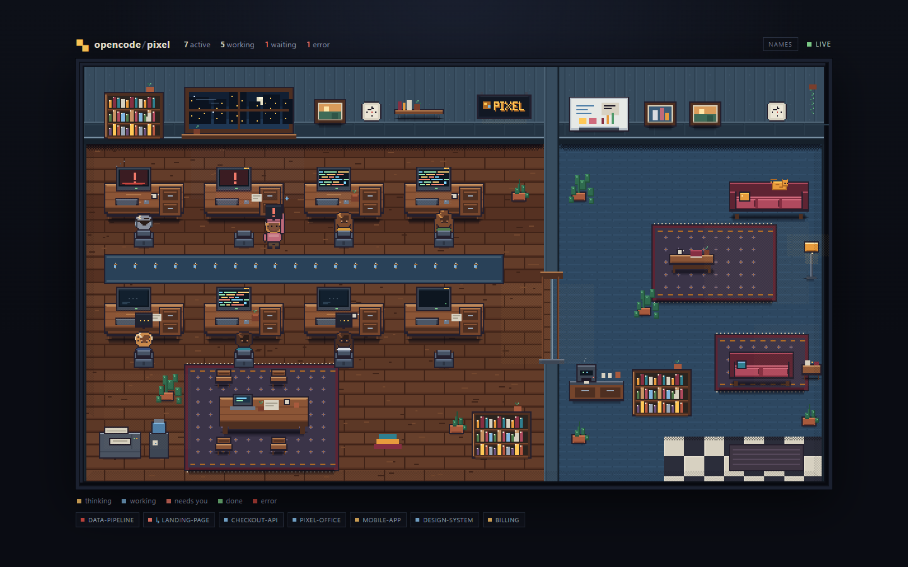

# opencode-pixel

A tiny pixel-art office for your [OpenCode](https://opencode.ai) agents. The office starts empty:
characters walk in when a session starts working, type while a tool runs, show a thought bubble while
the model thinks, stand up and wave when a permission is waiting, and celebrate before walking out.
Idle sessions stay offstage, so an unused office really is quiet.



The plugin listens to OpenCode V2's **global** event stream, so one dashboard shows every session on
the machine, not only the project it was loaded for.

## Features

- **An actual office** — eight hand-drawn desks, a lounge, meeting corner, kitchenette, plants, a cat
  and a night window. Original art, 600×340 logical pixels, rendered at 2× with crisp integer scaling.
- **Only active sessions** — working, thinking, waiting for permission, error and a short done
  celebration appear in the office. Idle sessions are hidden; when nothing is running, the room is
  empty and every chair stays visible.
- **Walking transitions** — new work enters through the lounge, crosses the divider, walks to a desk
  and sits down. When a session goes idle it walks back out; waiting/done agents stand up and step
  away from the keyboard. Done gets about four seconds of celebration first.
- **Subagent markers** — sessions created by a subagent get their own desk, a floating blue diamond in
  the scene and a `↳` marker in the roster.
- **Identification on demand** — a roster of active sessions below the scene, optional nameplates
  (`NAMES`), hover/click cards with project, status, tool, model and current task, plus desk hotspots.
- **Capacity-aware** — up to eight active sessions get desks. Extra active sessions are queued and
  take the next freed desk; the HUD shows `+N active hidden` while that happens.
- **Responsive** — layouts for 1440×900, 1024×768 and 390×844; reduced-motion users get instant state
  changes instead of walking animations.
- **Local only** — the HTTP server binds to `127.0.0.1`; the page has no external fonts, images or CDN
  requests.

| State | In the office |
| --- | --- |
| `working` | Seated, typing; the monitor streams coloured code. |
| `thinking` | Seated with an amber thought bubble and a pulsing monitor. |
| `waiting` | Stands beside the desk, waves, red `!` bubble and monitor. |
| `done` | Celebrates with a green check for ~4 seconds, then walks out. |
| `error` | Seated at a red monitor with pixel smoke. |
| `idle` | Not drawn; the office stays empty until work starts again. |

## Install

Requires OpenCode V2 and Node.js 20+.

Add the plugin to your OpenCode config (project or global):

```jsonc
{
  "plugins": [
    {
      "package": "opencode-pixel",
      "options": { "port": 5117, "autoOpen": true }
    }
  ]
}
```

Restart or reload OpenCode. On the first session event the dashboard opens once at
<http://127.0.0.1:5117>. If the port is busy, the plugin tries the next 11 ports.

### Options

| Option | Default | Meaning |
| --- | --- | --- |
| `port` | `5117` | Preferred dashboard port (tries the next 11 if busy). |
| `autoOpen` | `true` | Open the dashboard once, on the first event. |
| `idleTimeoutMs` | `1800000` | Drop sessions silent for this long. |
| `watchAllSessions` | `true` | `false` shows only the project the plugin loaded for. |

Environment overrides for development: `PIXEL_OFFICE_PORT`, `PIXEL_OFFICE_NO_OPEN=1`.

## How it works

```
opencode V2 (background service)
  └── opencode-pixel plugin (setup)
        ├── events.ts    event stream -> per-session agent state
        ├── state.ts     office snapshot (agents + stats)
        ├── server.ts    HTTP + SSE on 127.0.0.1:5117
        └── browser.ts   opens the dashboard once
                │
                └── web/  scene, sprites and canvas renderer
```

- The page consumes `text/event-stream` snapshots; the browser reconnects on its own.
- If another plugin instance already serves the dashboard, the new one forwards its events to it
  (`POST /api/ingest`) and takes over if the owner disappears.
- The room is pre-rendered once; only agents, chairs, screens, light and particles are composited each
  frame.

### HTTP API

| Route | Purpose |
| --- | --- |
| `GET /api/health` | `{ name, version, uptime }` — used to detect an existing dashboard. |
| `GET /api/state` | Current office snapshot (agents + stats). |
| `GET /events` | SSE stream of snapshots (`event: state`). |
| `POST /api/ingest` | Used by secondary plugin instances to forward events. |

## Development

```sh
npm install
npm run typecheck

# art preview with a deterministic demo state, no OpenCode needed
node spike/preview.mjs
# -> http://127.0.0.1:5180
```

Useful preview pages:

- `spike/preview.mjs` — demo dashboard with live state changes.
- `spike/sprite-lab.html` — all eight character looks and every pose.
- `spike/server-smoke.mjs` — checks static assets, API, HEAD and path-traversal handling.

The `.dev/` harness loads the plugin from source inside a real OpenCode project; see
[`docs/plugin-loading.md`](./docs/plugin-loading.md). Logs go to
`~/.cache/opencode-pixel/plugin.log`.

## Roadmap

- [x] V2 event catalog and state reducer
- [x] Plugin, local server, SSE, hub takeover
- [x] Original pixel-art office, character states, walking transitions
- [x] Subagent and permission visuals, responsive HUD
- [ ] npm release `0.1.0` and GitHub release

## License

[MIT](./LICENSE). All in-game art is original to this project; no third-party sprites, tilesets or
fonts are bundled. See [LICENSE-ASSETS.md](./LICENSE-ASSETS.md).
